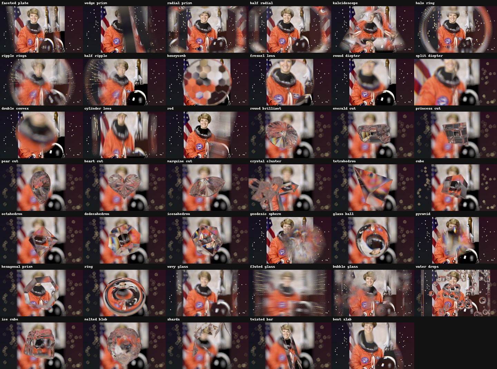
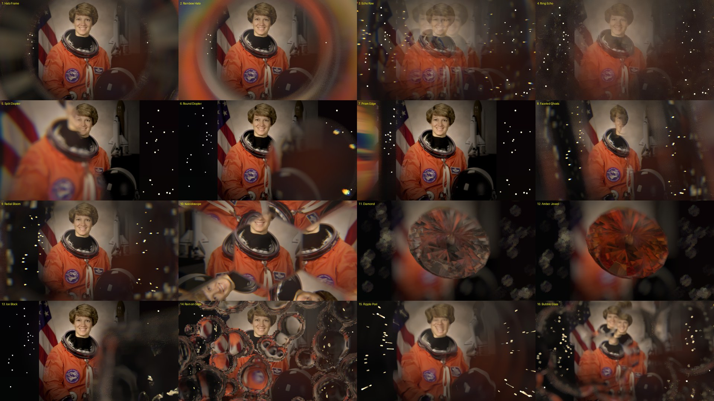

# FacetGlass

**Ray-traced glass in front of the lens, for DaVinci Resolve and other OpenFX hosts.**
Prisms, diopters, gems, crystals, ripple and kaleidoscope filters as real solid 3D
glass objects: light refracts in, bounces around inside and comes out, with
spectral dispersion, Fresnel reflections, bevelled edges catching the light, lens
depth of field and virtual lights.

Free and open source under the MIT licence.



## Features

- **Solid 3D glass, path-traced per pixel.** Snell refraction, total internal
  reflection with a bounce limit, Fresnel reflections outside and back inside the
  glass (faint ghost repeats, adjustable for stronger ghosts), rounded (bevelled) edges,
  rough reflections, continuous spectral dispersion (rainbow edges).
- Real glass types (crown, flint, dense flint, fused quartz, acrylic, sapphire,
  cubic zirconia, diamond, water) with their true strength and rainbow spread, and
  coloured glass whose tint deepens with thickness.
- On Lens mount: the glass becomes a filter on the lens, so the whole frame
  repeats through it: multi-image rows, circular ghosts and halo rings.
- **42 shapes** in six groups:
  - *Prisms & filters*: faceted plate (ghost repeats), wedge prism, radial prism
    (multi-image), half radial prism, kaleidoscope, halo ring, ripple rings
    (water ripple), half ripple, honeycomb, Fresnel lens
  - *Lenses*: round diopter, split diopter, double convex lens, cylinder lens, rod
  - *Gems*: round brilliant, emerald, princess, pear, heart and marquise cuts,
    crystal cluster
  - *Solids*: tetrahedron, cube, octahedron, dodecahedron, icosahedron, geodesic
    sphere, glass ball, pyramid, hexagonal prism, ring
  - *Organic*: wavy glass, fluted (shower) glass, bubble glass, water drops, ice
    cube, melted blob, shards, twisted bar, bent slab
  - *Custom*: load any **.obj** model (e.g. exported from Blender)
- **Real lens behaviour**: f-stop and focus (on the glass or on the footage), a
  separate *Glass Focus* for split-diopter looks, highlight boost for bokeh.
- **Placement in 3D**: position, depth, tilt, turn, roll and size, plus a
  procedural **hand-held** motion.
- **Outside the frame**: rays that leave the picture see a blurred, wrapped world
  (spherical, mirror, repeat, clamp, black or transparent), with feathering.
- **Virtual lights** with colour temperature that glint off the glass.
- **Colour managed**: traces in linear light; input Rec.709, sRGB, Sony S-Log3,
  ARRI LogC3 / LogC4, Panasonic V-Log or DaVinci Intermediate.
- **Optional Refract Source** input: show a different clip through the glass.
- **Fast on NVIDIA GPUs (CUDA)**, multithreaded CPU fallback. The CPU and GPU
  produce bit-identical images.
- **Low grain**: blue-noise low-discrepancy sampling, adaptive samples and an
  edge-aware **denoiser** that keeps facet edges and sharp detail.

## Looks

Pick a starting point from **Look** at the top of the controls, then adjust. Changing
any glass setting by hand turns Look back to Custom.



## Viewer controls

Select the FacetGlass node and set the viewer's on-screen controls to
**Open FX Overlay** (Color or Edit page). Every handle is colour-coded and shows
its value while you hover or drag:

| Handle | Colour | Drag to |
|---|---|---|
| Centre dot | white | move the glass |
| Arrows | red / green | move along x / y only |
| Outer ring | blue | roll |
| Tall / wide ellipse | red / green | tilt / turn |
| Inside the ring | — | spin freely (trackball) |
| Square on the ring | white | resize |
| Left arc | purple | f-stop |
| Right arc | orange | strength (index of refraction) |
| Top arc | yellow | focus (glass ← → footage) |
| Bar below | cyan | depth |
| Suns | light colour | move the virtual lights |

The render drops to draft quality while you drag and returns to full quality
when you let go.

## Install (Windows)

1. Download `FacetGlass-Windows.zip` from the
   [latest release](https://github.com/SaoudAlawi/facetglass-ofx/releases/latest),
   or build the plugin (below).
2. Copy the bundle to `C:\Program Files\Common Files\OFX\Plugins\` (needs admin),
   or run `powershell -ExecutionPolicy Bypass -File tools\install_windows.ps1`.
3. Restart DaVinci Resolve. FacetGlass appears under *OpenFX → FacetGlass*.

Tips: set **Technical → Input Colour Space** to match your footage (keep your
usual output transform after FacetGlass); use **Good** quality while working and
**Final** for delivery; **Denoise** 0.5 is a good default.

## Install (macOS)

1. Download `FacetGlass-macOS.zip` from the
   [latest release](https://github.com/SaoudAlawi/facetglass-ofx/releases/latest),
   or build the plugin (below). It is one universal bundle for Apple Silicon and Intel Macs, rendering on the
   GPU with Metal.
2. Copy the bundle to `/Library/OFX/Plugins/` (needs admin), or run
   `sh tools/install_macos.sh`. For a downloaded bundle, also run
   `sudo xattr -dr com.apple.quarantine /Library/OFX/Plugins/FacetGlass.ofx.bundle`
   (the plugin is not notarized yet).
3. Restart DaVinci Resolve.

## Build from source

Requirements: Visual Studio 2022 (MSVC), CMake 3.20+, optionally the CUDA Toolkit
(13.x) for the GPU backend, and Python 3 with `numpy pillow scikit-image` for the
tests.

```bat
set CUDA_PATH=C:\Program Files\NVIDIA GPU Computing Toolkit\CUDA\v13.5
cmake -S . -B build -G "Visual Studio 17 2022" -A x64 -T cuda="%CUDA_PATH%"
cmake --build build --config Release --parallel
```

The plugin is written to `build/FacetGlass.ofx.bundle/Contents/Win64/FacetGlass.ofx`
(static runtimes; it only depends on system DLLs and the NVIDIA driver). Without
the CUDA Toolkit, configure without `-T cuda=...` to build the CPU-only plugin.

macOS: the Xcode Command Line Tools (`xcode-select --install`) and CMake
(`brew install cmake`). Full Xcode is not needed: the Metal kernels are compiled
at run time from the same core source.

```sh
cmake -S . -B build -DCMAKE_BUILD_TYPE=Release
cmake --build build --parallel
```

The plugin is written to `build/FacetGlass.ofx.bundle/Contents/MacOS/FacetGlass.ofx`
(universal arm64 + x86_64, macOS 11+, ad-hoc signed).

## Tests

```bat
build\Release\fg3d_math_test.exe
python tests/fg3d_preview.py build/Release/fg3d_render.exe 480 270
build\Release\fg3d_gpu_test.exe tests\out\fg3d\in.raw 480 270
python tests/compare_ofx.py build/Release/fg_ofxhost.exe build build/Release/fg3d_render.exe
python tests/fg3d_noise.py build/Release/fg3d_render.exe
```

On macOS: `build/fg3d_metal_test tests/out/fg3d/in.raw 480 270` and
`python3 tests/compare_ofx.py build/fg_ofxhost build build/fg3d_render [--metal]`
(`--metal` hands the plugin Metal buffers and a command queue, as Resolve does).

- `fg3d_gpu_test` / `fg3d_metal_test`: CUDA / Metal must match the CPU exactly (including tiles, negative row
  strides, a 2x refract source and the denoiser).
- `compare_ofx.py`: loads the built plugin in a small OpenFX test host
  (`tests/ofxhost`) and checks it against the standalone renderer: shapes, tiles,
  render scale, quality presets, lights, motion, Refract Source, OBJ import,
  hosts without optional suites, identity.
- `fg3d_noise.py`: measures grain against a high-sample reference.
- `fg3d_preview.py`: renders the contact sheet above.

## How it works

- `src/core/fg3d_core.h` is the single source of the shading maths, compiled
  unchanged for the CPU, CUDA and Metal through a small prelude per
  backend. It uses its own exp/log/sin/cos and no fused multiply-add, which keeps
  every backend bit-identical.
- `src/host/` builds the glass: procedural shapes, OBJ import, smoothing, bevel
  data and a BVH; converts the UI values into the render parameters; runs the CPU
  CUDA and Metal passes (decode to linear, mip pyramid, trace, denoise, encode).
- `src/plugin/FacetGlassPlugin.cpp` is the OpenFX plugin: parameters, clips,
  scene cache, the viewer gizmo, and CUDA, Metal or CPU rendering.
- `reference/` holds the first (thin-glass) model and a Fusion Fuse, kept as a
  reference.

## Clean room

FacetGlass is an independent, clean-room project. Its algorithms and code are
original. It was designed from first principles and from publicly available
information only; no commercial plugin's code, binaries, presets or assets were
used. Notes on what public demos show are in `docs/research/`.

## Licence

MIT (see `LICENSE`). FacetGlass includes the OpenFX SDK (BSD-3-Clause); the test
host downloads expat (MIT) at build time. See `NOTICE`.
