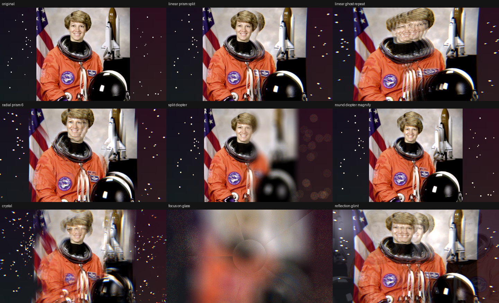

# FacetGlass

Ray-traced virtual glass for DaVinci Resolve and other OpenFX hosts: prisms, ghost repeats, split and round diopters, and crystal facets. Real refraction, spectral dispersion, aperture-accurate soft edges and bokeh.

**Status: in development.** The shared shading core is done and tested. The OpenFX plugin is next. A working Fusion Fuse preview is in `reference/fuse/`.

- Free and open source (MIT)
- Windows (CUDA / OpenCL / CPU) first, then macOS (Metal)

See `CLAUDE.md` for the architecture and roadmap.
